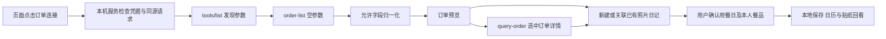

# 麦当劳 MCP 集成说明

## 实际接入

- Server：`https://mcp.mcd.cn`
- Transport：Streamable HTTP
- Authentication：本机 `MCD_MCP_TOKEN` 环境变量或 Git 忽略的 `.env.local`；Bearer 由服务端加入。
- SDK：官方 `@modelcontextprotocol/sdk` 1.32.1，依赖锁定于 package-lock.json。
- 业务工具：`order-list`、`query-order`。本项目不开放写操作工具。

**2026-10-20 已使用本人授权凭据完成真实只读调用。** 发现 35 项工具，读取近期订单 3 笔，查询其中一笔详情；并在浏览器完成关联、保存、刷新及再次关联不新增重复记录。公开材料只保留调用时间、工具、计数、结构和结果摘要，不包含原订单、账号或照片。见 [验证记录](docs/mcp-verification.md)。

## 调用流程



静态 GitHub Pages 展示示例手帐与完整照片记录能力；真实订单由下载后的**本机版**读取。公开网站不收集 MCP Token，也不会访问此仓库作者的订单。

## 已发现参数与映射

| 工具 | 参数 | 已验证响应字段 | 用途 |
|---|---|---|---|
| `order-list` | `{}` | `data.list[]` | 近期候选列表 |
| `query-order` | `{ "orderId": "列表返回的原标识" }` | `data` | 补充选中订单 |

返回结果以 SDK 的 `structuredContent` 为主。校验工具错误与 `success/code` 后读取业务数据。未得到结构化结果或 JSON 时明确失败，不把无法解析的文字编造成订单。

| 来源字段 | 内部字段与口径 |
|---|---|
| `orderId` | 服务端按当前凭据命名空间做 SHA-256 摘要，原标识仅用于详情查询，不传给页面 |
| `createTime` | `date/createdAt`，作为下单日期建议；用户确认实际用餐日期 |
| `orderStatus` | 原状态标签；已验证样本为「订单已完成」，其余未识别状态不自动认定已吃 |
| `storeName` | 本机预览门店名；不取配送地址 |
| `realTotalAmount` | 元字符串转整数分，保留两位；未知为 null，0 是有效数值 |
| `orderProductList[].productName/quantity` | 主餐品及数量 |
| `comboItemList[].name/quantity` | 实际返回的套餐子项，保留层级，不套用当前菜单 |

金额不自动填到个人花费。用户选择本人餐品后保存；不做个人营养摄入计算。商品名称推断的插画种类只用于占位，不作为图片识别或餐品身份证明。

## 可靠性与保护

- 不承诺完整历史或全渠道：本次只有接口可见的 3 笔，不推算缺失月份。
- 同一凭据下订单摘要稳定，再次选择已关联订单进入原页。用户可以显式选择关联已有照片页，创作字段保留。
- 凭据轮换后的订单摘要可能变化；应优先关联已有页面，不承诺跨凭据自动去重。
- 列表缓存中的原标识仅存在服务端内存。Token、原始验证响应、个人资料所在目录均由 `.gitignore` 排除。
- 默认仅 `127.0.0.1:4880`；检查 Host/Origin；读接口使用一次会话防跨站令牌。服务器只提供 index 和有限 API，不开放项目目录。
- 配送信息、电话、取餐码、支付链接、支付 ID、订单备注及精确地址均不进入归一化结果。
- 缺字段、401、429、超时、未知状态以可理解提示处理；不会清除已保存手帐。
- 日记照片保存在浏览器 IndexedDB，备份由用户主动下载；无自动外发。

## 业务价值

MCP 提供可核对的餐品、日期和订单事实，减少重复抄写；照片与随记保留生活情境。用户确认实际吃了什么后，形成可按年月日回看的手帐，而不是将整张订单误当个人摄入。

## 重现

```text
npm ci
# 将 .env.example 复制为 .env.local 并填入自己的凭据；文件保持本机私有
npm start
# 浏览器打开 http://127.0.0.1:4880 → 订单连接 → 读取近期订单
```

CLI 可选：`npm run mcp:discover`、`npm run mcp:orders`。原始结果只写入被 Git 忽略的 `private/`；不可将这些原始文件公开。配置示例中的 `${MCD_MCP_TOKEN}` 是占位符，不保证各客户端自动展开，需遵循所用客户端的配置方式。

参考：[麦当劳官方接入指南](https://github.com/M-China/mcd-mcp-server)。
