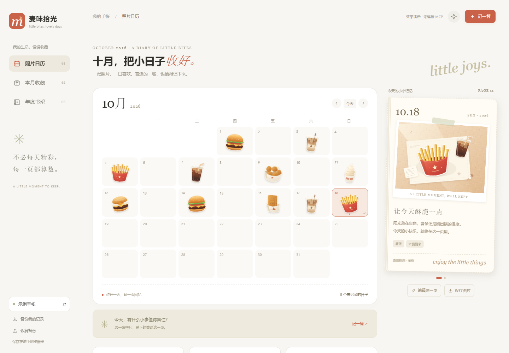
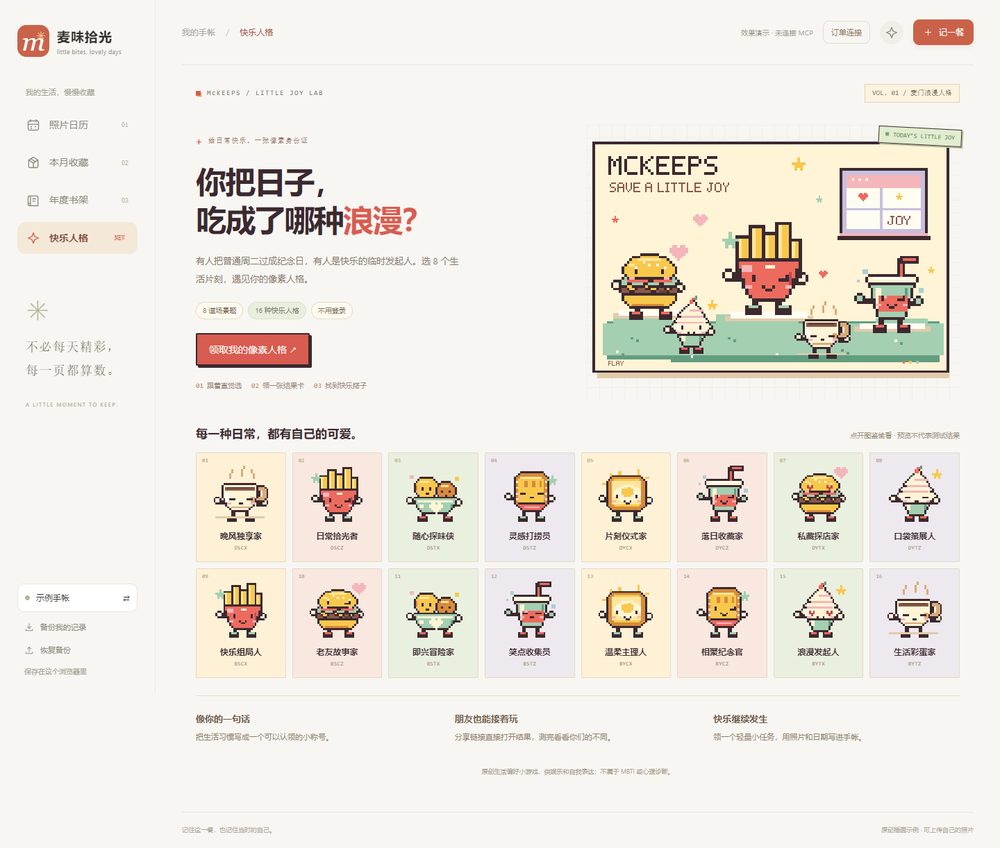

# 麦味拾光 · McKeeps

**拍一张，留一页。把吃过的麦，慢慢收成自己的日记。**

[在线体验](https://17-log.github.io/mc-keeps/) · [动效录屏](https://17-log.github.io/mc-keeps/demo-motion.webm) · [MCP 接入说明](MCP_INTEGRATION.md) · [真实验证](docs/mcp-verification.md)

[麦门浪漫人格](https://17-log.github.io/mc-keeps/#persona) · [功能与隐私说明](docs/personality.md) · [调研与传播设计](docs/virality-research.md) · [WorkBuddy 接续方案](docs/workbuddy-optimization.md)



麦味拾光是一款面向喜欢拍食物、保存生活碎片的人的照片手帐。日历收录一餐，点击日期翻开照片和随记；本月收藏中可以拖动食物贴纸、播放连续回顾；年度书架按月份收藏回忆。

本机版通过麦当劳中国 MCP **真实读取近期订单和指定订单详情**。订单提供餐品和下单事实，用户确认实际用餐日期、本人餐品后再写入日记。多人订单不会自动全部记成个人摄入，整单金额也不会自动填成个人花费。

## 先体验，再决定是否连接

直接打开 [在线演示](https://17-log.github.io/mc-keeps/)，无需注册或 Token：

1. 点日历中的日期查看日记，10 月 18 日有两餐。
2. 「记一餐」上传自己的照片，写一句话，保存时贴纸落入日期。
3. 「本月收藏」拖动、轻抛贴纸，或点击「轻轻晃一下」。
4. 「播放贴纸回顾」可以暂停、前后翻页和重播。
5. 「年度书架」点击某月，翻回那时的小日子。
6. 左下「示例手帐 ⇄」或手机底部「空间」切换到自己的空白手帐。

在线版的预置内容为明确的原创插画和虚构记录，不会读取仓库作者的订单。照片、文字与新建记录保存在你自己的浏览器 IndexedDB，清理网站数据或换浏览器前请主动备份。

## 新增扩展：麦门浪漫人格

在同一 McKeeps 仓库中，以「你把日子，吃成了哪种浪漫？」作为照片手帐的新入口：完成 8 道生活场景题，按 4 条生活偏好轴生成 16 种原创人格之一。结果包含原创像素食物角色、一句生活文案、可展开的评分解释和一个轻量小任务。它是娱乐与自我表达小游戏，不是 MBTI、心理诊断或经过科学验证的人格测量。

- 分享结果深链，朋友先看到你的卡片，再自测或用上次结果对照相同与不同的偏好；没有匹配百分比、稀有度或人格排行。
- 保存 1080 × 1440 PNG 人格卡，内含指向同一结果的二维码；支持系统分享及复制链接 / 文案。
- 「带着小任务，记一餐」打开原手帐的个人草稿，预填任务与文案，由你确认食物、日期、照片后主动保存到日历。
- 评分仅来自这次的 8 个答案；手帐照片、订单和消费金额不参与评分。结果链接只带版本、角色码和 4 条刻度，持有链接的人可以看到这份结果摘要。

本地预览也使用原项目的公开地址生成分享链接。完整流程、刻度规则、本地保存范围和文件说明见 [docs/personality.md](docs/personality.md)，实际验证范围见 [人格验证记录](docs/personality-validation.md)。



[查看实际导出的人格卡](assets/persona-card.png) · [查看手机首屏](assets/persona-mobile.png) · [打开一张示例分享结果](https://17-log.github.io/mc-keeps/#persona?v=p1&r=p1.BYCZ.2s2s002s)

## 已实现

- 照片上传、本地压缩；日期、标题、随记、心情、个人花费、两款原创模板。
- 新建、编辑、删除、同日多餐；日 / 月 / 年回看。
- 保存时收进日历、纸页展开、8 款原创食物贴纸、可拖动碰撞的收藏盒、贴纸回顾。
- 本机 MCP 只读订单查询、详情查询、个人餐品勾选、关联已有照片日记。
- 再次选择同一订单继续编辑原日记，保留照片、日期与随记。
- 日记 PNG、月历 PNG；包含照片的 JSON 备份和恢复。
- 示例与个人空间；减少动态效果开关、键盘操作与手机布局。

分享图长文会节选，完整文字保留在原记录与备份。单份备份上限 500 页或 45 MB，超限会提示。贴纸回顾支持播放，未实现将回顾导出视频文件。

## 安装与运行

需要 Node.js 22 或更高版本。

```sh
git clone https://github.com/17-log/mc-keeps.git
cd mc-keeps
npm ci
npm start
```

浏览器打开 **http://127.0.0.1:4880**。没有 Token 时仍可使用全部照片手帐功能。原来的纯静态首版预览端口为 4877；当前可读真实订单的本机版使用 4880。

只看界面也可直接打开单文件 `index.html`，无需安装依赖或联网。静态文件和网站不承担真实订单服务。

## 真实订单连接

1. 在 [麦当劳中国 MCP 平台](https://open.mcd.cn/mcp) 激活自己的 Token。
2. 复制 `.env.example` 为 `.env.local`，把 `MCD_MCP_TOKEN` 的占位符替换为自己的值。该文件由 Git 忽略。
3. 启动本机版，打开页面「订单连接」→「读取近期订单」。
4. 需要时查看详情；选择新建日记或关联已有照片日记。
5. 确认实际用餐日期，勾选本人餐品并保存。金额不确定可以留空。

**2026-10-20 已完成真实 MCP 联调**：发现 35 项工具，查询到 3 笔近期订单及其中一笔详情，浏览器保存、刷新和再次关联均已验证。[验证摘要](docs/mcp-verification.md)

实际业务工具仅有 `order-list({})`、`query-order({orderId})`。没有点餐、支付、取消、领券、兑换或抽奖功能。工具的调用、字段、去重范围和错误处理见 [MCP_INTEGRATION.md](MCP_INTEGRATION.md)。

Token 只由本机后端读取；公开网站不接收 Token。近期可见记录不代表完整历史，不保证全渠道或全年补录。原订单号、配送地址、电话、取餐码和支付资料不会进入页面或分享图。

CLI 可选验证：

```sh
npm run mcp:discover
npm run mcp:orders
```

验证原始结果保存到本机被忽略的 `private/`；不要公开该目录。更换 Token 后摘要标识可能改变，应优先选择关联已有日记。

## 测试与构建

```sh
npm test
npm run build
```

自动测试覆盖金额单位、无效日期、来源资料裁剪、重复订单、账号命名空间与失败响应，以及人格全部 65,536 份答案组合、16 型可达性、结果链接编解码与隐私。浏览器实际操作检查见 [VALIDATION.md](VALIDATION.md) 和 [人格验证记录](docs/personality-validation.md)。手机检查为 Chromium 模拟视口，尚未覆盖全部真实设备。

`build.js` 将原生 HTML / CSS / JavaScript 合并为单个离线 HTML。GitHub Actions 先运行测试，再只发布界面和示例录屏，不部署个人订单后端或本机配置。

## 文件与原创说明

- `app.js` / `data.js`：记录、年月日回看、导出和 IndexedDB。
- `art.js`：8 款原创食物 SVG 与餐桌插画；占位插画不是用户实拍。
- `motion.js` / `motion.css`：贴纸物理交互。
- `persona-engine.js`：8 题、4 轴、16 个原创角色，可解释评分、版本化结果链接与偏好对照。
- `persona-ui.js` / `persona.css`：答题、结果、好友入口、分享、二维码和 PNG 导出；通过 `app.js` 接回原手帐草稿。
- `persona-art.js`：8 类原创 32 × 32 像素食物角色与表情变体，页面和 PNG 共用绘制定义。
- `docs/personality.md` / `THIRD_PARTY_NOTICES.md`：人格功能与隐私边界、二维码依赖许可。
- `orders-ui.js` / `lib/`：本机只读 MCP 查询、字段归一化、日记关联。
- `SKILL.md`：只读订单手帐流程说明，可供支持 Skill 的客户端采用。
- `mcp-config.example.json`：仅环境变量占位符的连接器配置示例。
- `CONTEST_DECLARATION.md`：官方原样参赛声明。

本项目借鉴照片日历与生活记录的一般交互思路，代码、食物插画、排版和动画由本项目独立实现，没有使用 Sipor 或其他应用的代码、贴纸或图片；不声称相似玩法由本项目首创。开发使用 Codex，当前不申报 WorkBuddy 专项，没有伪造 `workbuddy.md`。

麦当劳程序员创意开发大赛参赛作品，由参赛者独立开发，非麦当劳官方产品。餐品与订单事实以官方服务实际结果为准，项目不提供医疗或营养建议。

开源许可：[MIT](LICENSE)。麦当劳品牌名称属于其权利人，开源许可不授予相应商标权。

第三方二维码库 `qrcode-generator` 2.0.4 使用 MIT 许可，完整版权与许可声明见 [THIRD_PARTY_NOTICES.md](THIRD_PARTY_NOTICES.md)。
